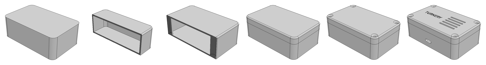
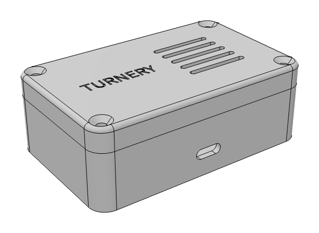
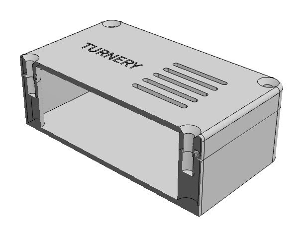
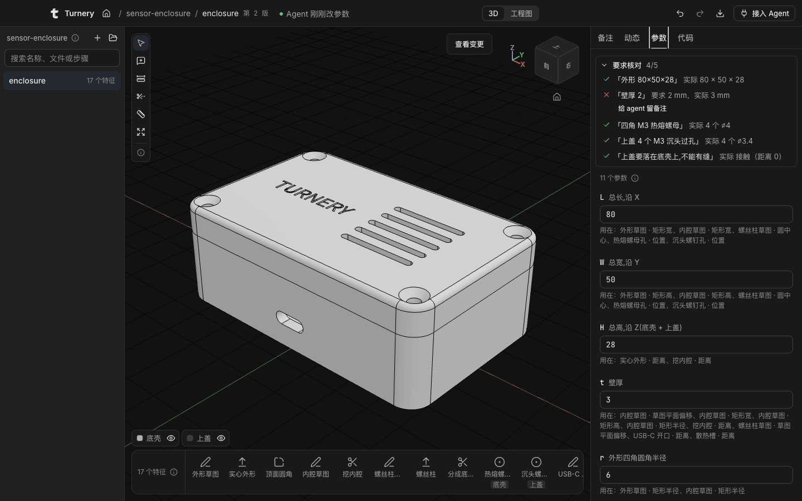
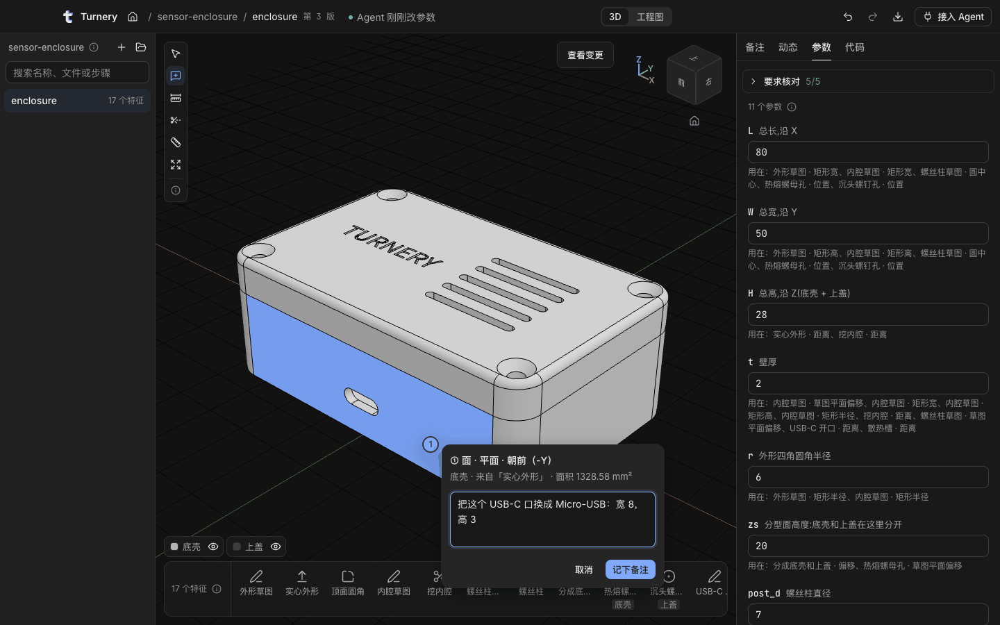
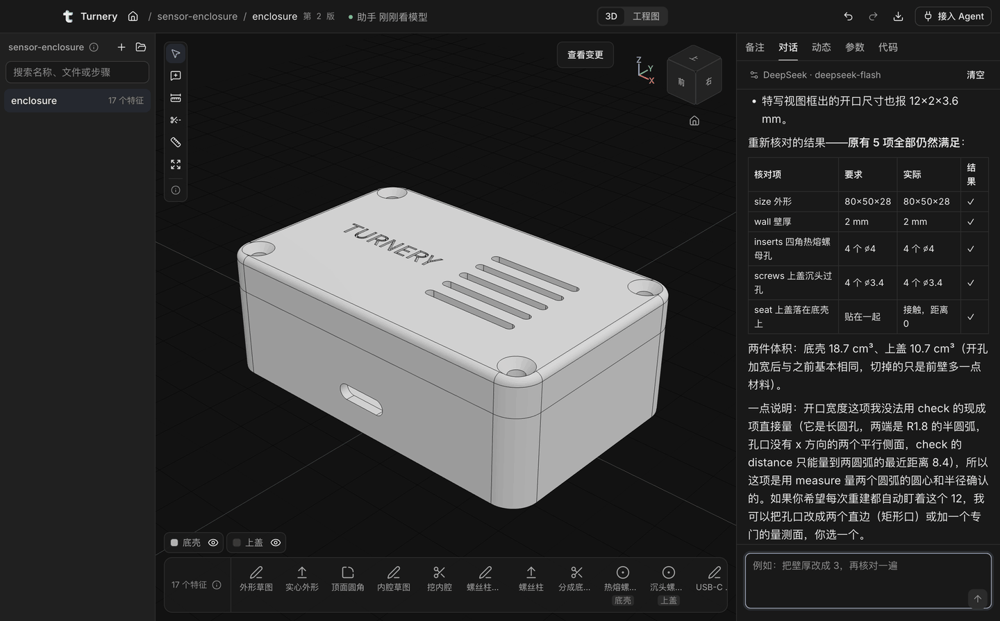

<p></p>

# Turnery

**Parametric CAD that your coding agent builds and you can read, check and change.**

[简体中文](README.zh-CN.md) · [Download for macOS](https://github.com/linjiejim/turnery/releases/latest) · [Website and course](https://turnery.linjiejim.com) · [Example](examples/sensor-enclosure)


<sub>A 27-second animation of the idea, not a screen recording. With sound: [`turnery-intro-en.mp4`](docs/media/turnery-intro-en.mp4).</sub>

Turnery is a desktop app with an MCP server. Claude Code, Codex or any other MCP agent on your machine calls 40 modeling tools; an OpenCascade kernel computes the geometry; you watch every step in a 3D window, drag parameters, and leave notes on faces for the agent to act on.

What the agent hands you is a **feature tree**: named parameters, ordered features that each say why they exist, and a list of your requirements that the kernel re-measures on every rebuild. It is one JSON file. It diffs, it goes in git, and you can open it a month later and change the wall thickness.

## Why a feature tree

Ask a model for a 3D part today and you usually get one of two things.

| You get | What happens when you say "make the walls 3 mm" |
| --- | --- |
| A mesh (text-to-3D) | Nothing to edit. Generate again and hope the rest stays the same. |
| A script (OpenSCAD, CadQuery, KCL…) | Editable, if you read the code and it still runs. Nothing tells you the holes are still where you asked. |
| **An Turnery feature tree** | Change `t` from 2 to 3. Everything that referenced it follows, and the check "wall 2 mm" turns red because that is not what you asked for. |

The design choices behind that:

- **Tools with schemas, not generated code.** The agent can only change the tree through validated tool calls. A failed feature comes back with the reason and a suggested fix, so the agent repairs that step and does not stack a workaround on top.
- **Selectors by meaning.** Faces and edges are picked by description (`{ normal: "+Z", extreme: "+Z" }`, "the edges of the top face, outer loop only") and resolved again on every rebuild. There are no face IDs to go stale when an earlier feature changes.
- **The agent can look and measure.** `look` renders views, sections and close-ups for it. `measure` returns distances from the kernel. It does not have to trust its own arithmetic, and neither do you.
- **Requirements are stored and re-checked.** `check` turns "80×50×28, 2 mm walls, four M3 holes" into items the kernel measures after every change: size, wall thickness, hole count and diameter, clearances to an imported board, gaps between parts.
- **Two-way with you.** Click a face, write "USB-C opening here, 6 mm above the floor", and the agent's next call sees the note with the face and coordinates. The agent can also ask you to click the face it is unsure about.
- **Your agent, your subscription.** With Claude Code or Codex connected, Turnery calls no model and needs no API key. Without one, the built-in assistant uses a model and key you choose.

## What a session looks like

The request, in one message:

> Build a sensor enclosure with turnery: 80×50×28, 2 mm walls, R6 corners. Split it into a base and a lid, held by four M3 countersunk screws into heat-set inserts. USB-C opening in the front wall, five vent slots and "TURNERY" engraved on the lid. Check the dimensions and take a look when you are done.

Fifteen tool calls later:



<p>


</p>

```
✓ size     80 × 50 × 28                  measured 80 × 50 × 28
✓ wall     2 mm                          measured 2 mm
✓ inserts  4 × M3 heat-set insert        measured 4 × ⌀4
✓ screws   4 × M3 countersunk clearance  measured 4 × ⌀3.4
✓ seat     lid sits on the base, no gap  measured contact (0 mm)
```

What you see in the window when the wall is changed to 3 mm: the part follows, and the request "wall 2" is flagged (the interface is in Chinese for now).



When words are not enough, click the face and write the note there. The agent receives the face, where it came from and your text.



The whole result is [`examples/sensor-enclosure/enclosure.turnery.json`](examples/sensor-enclosure/enclosure.turnery.json): 11 parameters, 17 features, 5 checks. One feature from it:

```json
{
  "id": "posts",
  "name": "螺丝柱",
  "intent": "柱子从内底一直长到内顶:分型后下半段装热熔螺母,上半段让螺钉穿过。改总高时柱子跟着变",
  "op": "extrude",
  "sketch": "sk_posts",
  "until": "next"
}
```

The `intent` reads: "the posts run from the floor to the ceiling; after the split the lower half takes the insert and the screw passes through the upper half. They follow the total height." Open that file, set `H` to 40, and the posts grow to 36 mm on their own, because the feature says "until the next face" and not "24 mm".

## Install

1. Download `Turnery-<version>-arm64.dmg` (Apple silicon) or `-x64.dmg` (Intel) from [Releases](https://github.com/linjiejim/turnery/releases/latest) and drag Turnery to Applications.
2. Turnery is not signed with an Apple certificate yet. On first launch macOS blocks it: open System Settings → Privacy & Security and choose "Open Anyway", or run

   ```bash
   xattr -dr com.apple.quarantine /Applications/Turnery.app
   ```

3. Connect your agent. In Claude Code, install the plugin (the MCP server plus a skill that tells Claude when and how to use it):

   ```
   /plugin marketplace add linjiejim/turnery
   /plugin install turnery@turnery
   ```

   Or add the server by hand; the "接入 Agent" button in the window shows the exact command for your machine:

   ```bash
   claude mcp add --scope user turnery -- /Applications/Turnery.app/Contents/Resources/bin/turnery mcp
   ```

   ```bash
   codex mcp add turnery -- /Applications/Turnery.app/Contents/Resources/bin/turnery mcp
   ```

   Any other MCP client: `command` is that `turnery` path, `args` is `["mcp"]`.

4. Tell the agent what to build. Start with "use turnery to…".

No agent yet? The first time Turnery starts it opens the example above. Change `t` in the parameter panel and watch the check list.

### Or use the built-in assistant

The 对话 (chat) tab in the window runs the same tools with a model you pick: DeepSeek, OpenRouter, Anthropic, OpenAI, Gemini, Moonshot, Zhipu, DashScope, SiliconFlow, a local Ollama, or any OpenAI-compatible endpoint. It can call Turnery's modeling commands and nothing else: no other files, no shell. Your key stays on your machine, outside the project folder.



The same loop runs from a terminal, with or without the window:

```bash
turnery model use deepseek
```

```bash
turnery ask "make the walls 3 mm and check again" --part box
```

The app updates itself from GitHub Releases; update packages are verified against a key built into the app.

## How it fits together

```
Claude Code / Codex ──MCP (stdio)──► turnery mcp ──HTTP 127.0.0.1──► Turnery app: engine ◄──IPC──► window
                     turnery CLI ───────────────────┘                  │ OpenCascade (WASM) in a worker thread
                                                                      ▼
                                              your project folder: part.turnery.json, part.notes.json
```

- A folder is a project. Parts are `*.turnery.json`, assemblies are `*.turnery-asm.json`, shared parameters are `*.params.json`.
- Edits can come from the agent, from you in the window, or from a text editor or git. All of them land in one history with undo. When you change something, the agent's next result starts with what you changed, so it does not put your edit back.
- The same engine runs without a window: `turnery check part.turnery.json --no-app` works in CI.

## The tools

| Group | Tools |
| --- | --- |
| Parts and assemblies | `open_project` `open_part` `list_parts` `get_state` `share_params` `guide` |
| Modeling | `set_params` `sketch` `extrude` `revolve` `sweep` `loft` `fillet` `chamfer` `shell` `draft` `hole` `thread` `rib` `split` `mirror` `linear_pattern` `circular_pattern` |
| Bought-in and standard parts | `import` (STEP files as reference bodies) · `component` (parts, sub-assemblies, STEP files, ISO screws, nuts, washers and heat-set inserts, placed with mates) |
| Editing the tree | `edit_feature` `delete_feature` `move_feature` `set_tree` `undo` `redo` |
| Seeing | `look` (views, sections, close-ups, with a scale) · `inspect` · `measure` |
| Checking and delivering | `check` · `export` (STEP, STL, build123d Python, JSON, bill of materials) |
| Working with you | `get_notes` `resolve_note` `request_pick` `show` |

Full reference, the CLI and the internals: [`desktop/README.md`](desktop/README.md) (Chinese).

## Where it stands

Turnery is at 0.5 and moving fast. What works today: single parts and multi-part assemblies with shared parameters, standard fasteners, real thread geometry, STEP import for building around a board, engineering drawings, and the check list described above.

What does not, yet:

- **macOS only**, and unsigned. Windows and Linux builds are planned.
- **The interface is in Chinese**: window, tool descriptions, kernel messages and the agent guide. Tool names and JSON schemas are English. An English interface is the first thing on the roadmap.
- **No sketch constraint solver in the modeling tools.** Sketches are written with parameters and expressions.
- **No free-form "code feature"** for shapes the tree cannot express.
- **Mates place parts once, in order.** They are not a constraint system and there is no motion.
- **Faces of an imported STEP can be measured, checked and sketched on, but not clicked in the window yet.**

## Turnery and its neighbours

Giving a coding agent CAD skills is a busy field, and several projects do parts of it well. Where Turnery sits, as of November 2026:

| If you want | Look at | How Turnery differs |
| --- | --- | --- |
| The agent to write CAD code you keep as source | [text-to-cad](https://github.com/earthtojake/text-to-cad), [agentcad](https://github.com/jdilla1277/agentcad), [torno](https://github.com/luisg0nc/torno) (build123d), [CADAM](https://github.com/Adam-CAD/CADAM) (OpenSCAD) | The model is a feature tree you can read and edit without reading code. Turnery exports build123d when you want the script. |
| A full open-source CAD application with an agent interface | [SolidCraft](https://github.com/tangency-labs/solidcraft), [Chili3D](https://github.com/xiangechen/chili3d), [Zoo Design Studio](https://github.com/KittyCAD/modeling-app) | Turnery is not a general CAD program. It is narrower: the agent builds, the kernel checks, you steer. Faces are selected by meaning, and your requirements stay in the file as checks. |
| An agent inside the CAD package you already use | [freecad-mcp](https://github.com/neka-nat/freecad-mcp), Autodesk's Fusion MCP, Onshape's FeatureScript MCP | No CAD package needed. The file is plain JSON in your repository. |

What we have not found elsewhere in one tool: semantic selectors, a persistent requirement check list, notes pinned to faces, and the agent asking you to click a face when your words are ambiguous. If another project does this and we missed it, open an issue and we will correct this table.

## Also in this repository: the course

[turnery.linjiejim.com](https://turnery.linjiejim.com) is a Chinese-language, software-neutral course on mechanical CAD built on the same kernel and file format: 21 interactive lessons, 17 illustrated cards, 9 teardowns of real parts that replay feature by feature, a command atlas across 8 CAD packages, and a browser workbench with an AI tutor. The desktop app is for making things; the site is for learning why they are made that way.

## Develop

```bash
cd app && npm install
npm run dev          # the website on http://localhost:5287
npm run check        # types, lint, design guards, unit tests

cd ../desktop && npm install
npm run build && npm start     # the desktop app from source
```

See [`CONTRIBUTING.md`](CONTRIBUTING.md), and [`README.zh-CN.md`](README.zh-CN.md) for the full developer notes: end-to-end tests, baking teardown models, the layout of the repository.

## License

Code is MIT ([`LICENSE`](LICENSE)). Course text and documentation are CC BY 4.0 ([`LICENSE-content`](LICENSE-content)). Third-party components, including OpenCascade (LGPL-2.1 with exception, shipped as a separate WASM file), are listed in [`THIRD_PARTY.md`](THIRD_PARTY.md).
