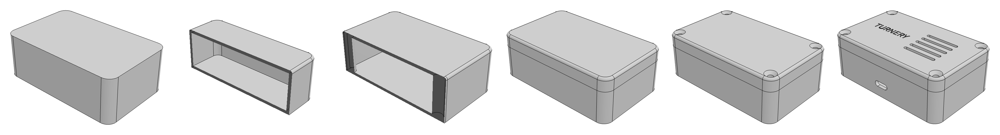
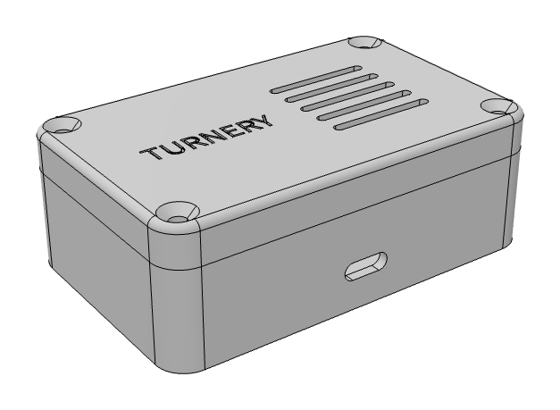
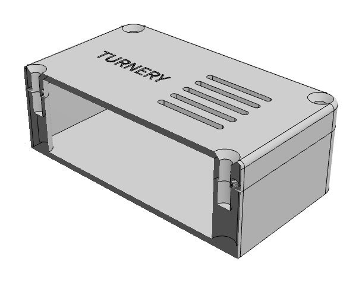
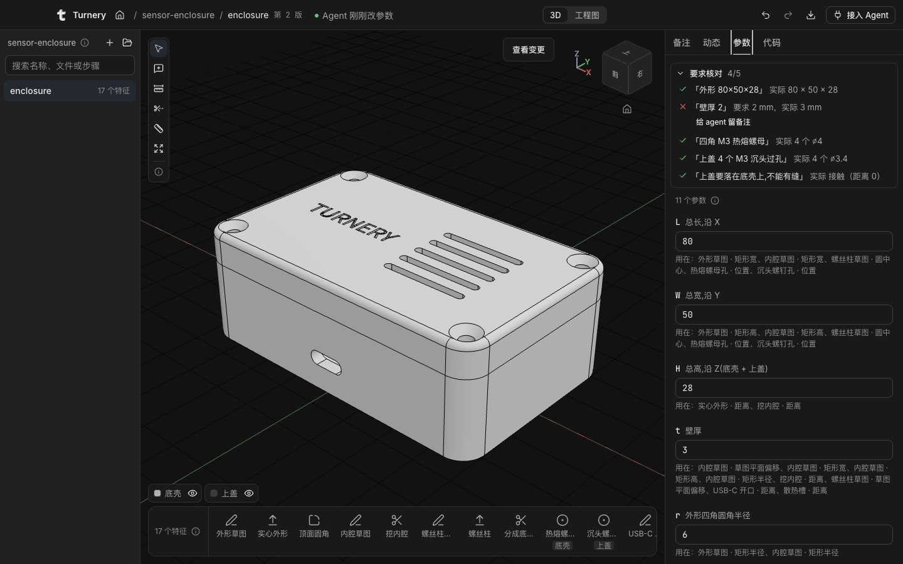
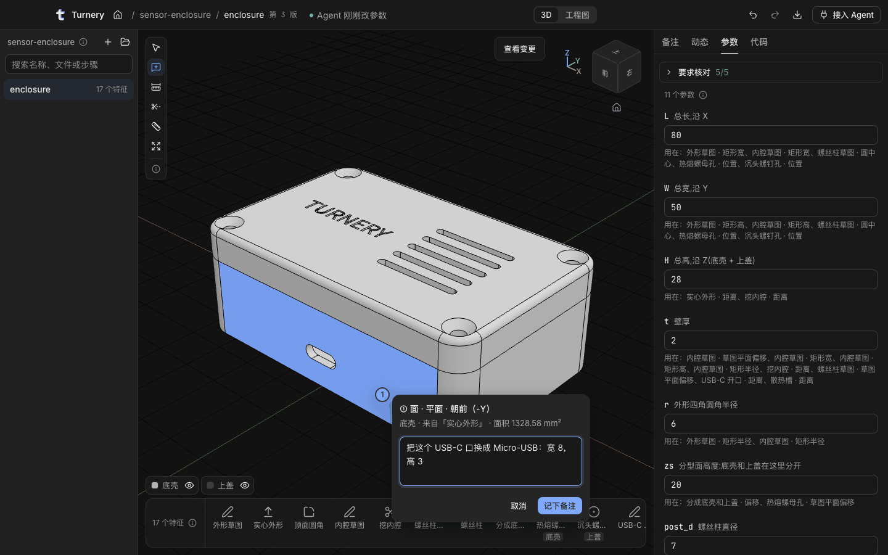
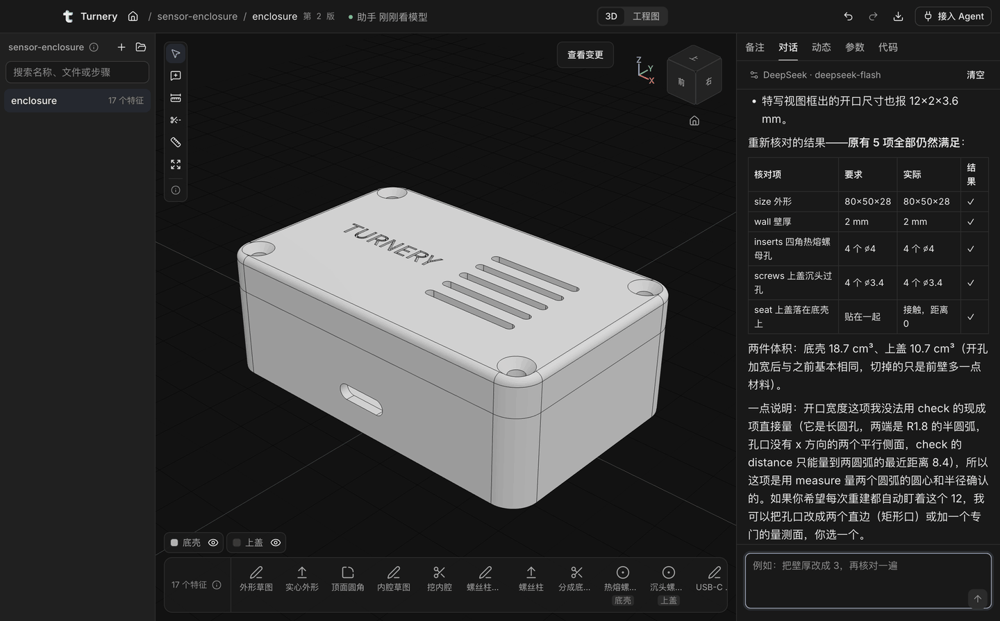

<p></p>

# Turnery

**让你的 coding agent 建参数化零件；建出来的东西你看得懂、核得准、改得动。**

[English](README.md) · [下载 macOS 版](https://github.com/linjiejim/turnery/releases/latest) · [网站和课程](https://turnery.linjiejim.com) · [示例](examples/sensor-enclosure)


<sub>27 秒的理念动画，不是录屏。带声音的版本：[`turnery-intro-zh.mp4`](docs/media/turnery-intro-zh.mp4)。</sub>

Turnery 是一个带 MCP 服务的桌面应用。你电脑上的 Claude Code、Codex 或任何支持 MCP 的 agent 调用 40 个建模工具，几何由 OpenCascade 内核算出；你在 3D 窗口里实时看每一步，拖参数，在面上留备注让 agent 去改。

agent 交给你的是一棵**特征树**：有名字的参数，一步步的特征（每一步都写着为什么这样做），还有一张由内核在每次重建后重新量一遍的需求核对表。它就是一个 JSON 文件，能 diff，能进 git，一个月后打开还能把壁厚改掉。

名字：turnery 是车削工坊，把料夹在轴上一刀刀车出形状的地方；turn 也是 agent 的一轮。标志是一个拉出厚度的小写 t，顶上斜切一刀：草图拉伸成实体，参数化建模的第一步。

## 为什么是特征树

现在让模型做一个 3D 零件，通常得到两种东西之一。

| 你得到 | 说一句「壁厚改成 3」会怎样 |
| --- | --- |
| 一个网格（文生 3D） | 没法改。重新生成一次，其余部分还一样不一样看运气。 |
| 一段脚本（OpenSCAD、CadQuery、KCL……） | 能改，前提是你读得懂代码、改完还能跑。孔还在不在你要的位置，没人告诉你。 |
| **Turnery 的特征树** | 把 `t` 从 2 改成 3。引用它的地方都跟着变，「壁厚 2」这项核对变红，因为这不是你当初要的。 |

背后的几个取舍：

- **带 schema 的工具，不是生成代码。** agent 只能通过校验过的工具调用来改特征树。某一步失败时，结果里写着原因和修法，agent 修这一步，而不是在上面再叠一个特征绕开。
- **按意思选面选边。** 面和边用描述来选（`{ normal: "+Z", extreme: "+Z" }`、「顶面的外轮廓边」），每次重建重新解析。前面的特征改了，也没有会失效的面编号。
- **agent 能看、能量。** `look` 给它渲染视图、剖面和特写；`measure` 的距离由内核算出。它不用相信自己的心算，你也不用。
- **需求存下来，反复核对。** `check` 把「80×50×28、壁厚 2、四个 M3 孔」变成内核每次改动后都重量一遍的条目：外形、壁厚、孔数和孔径、和导入的开发板之间的间隙、零件之间贴没贴上。
- **和你双向配合。** 点一个面，写「这里开 USB-C 口，下沿离底 6」，agent 下一次调用就读到这条备注，连同这个面和坐标。agent 拿不准你指的是哪个面时，也能请你在模型上点一下。
- **用你自己的 agent 和订阅。** 接了 Claude Code 或 Codex 时，Turnery 不调用任何模型，不需要 API key。没有 agent 时，内置助手用你自己选的模型和 key。

## 一次建模是什么样

一句话需求：

> 用 turnery 建一个传感器外壳：外形 80×50×28，壁厚 2，四角 R6。分成底壳和上盖，四角用 M3 沉头螺钉拧进底壳的热熔螺母。前壁开一个 USB-C 口，上盖开 5 条散热槽，刻上 TURNERY。建完核对尺寸再看一眼。

15 次工具调用之后：



<p>


</p>

```
✓ size「外形 80×50×28」：要求 80 × 50 × 28，实际 80 × 50 × 28
✓ wall「壁厚 2」：要求 2 mm，实际 2 mm
✓ inserts「四角 M3 热熔螺母」：要求 4 个 ⌀4，实际 4 个 ⌀4
✓ screws「上盖 4 个 M3 沉头过孔」：要求 4 个 ⌀3.4，实际 4 个 ⌀3.4
✓ seat「上盖要落在底壳上,不能有缝」：要求 贴在一起，实际 接触（距离 0）
```

把壁厚改成 3 之后窗口里的样子：零件跟着变，「壁厚 2」这项要求被标红。



说不清改哪里的时候，点那个面，把话写在面上。agent 收到的是这个面、它来自哪个特征，以及你写的话。



全部结果就是 [`examples/sensor-enclosure/enclosure.turnery.json`](examples/sensor-enclosure/enclosure.turnery.json)：11 个参数、17 个特征、5 项核对。其中一个特征：

```json
{
  "id": "posts",
  "name": "螺丝柱",
  "intent": "柱子从内底一直长到内顶:分型后下半段装热熔螺母,上半段让螺钉穿过。改总高时柱子跟着变",
  "op": "extrude",
  "sketch": "sk_posts",
  "until": "next"
}
```

打开这个文件，把 `H` 改成 40，螺丝柱自己长到 36 mm：因为这个特征写的是「长到下一个面为止」，不是「24 mm」。

## 安装

1. 从 [Releases](https://github.com/linjiejim/turnery/releases/latest) 下载 `Turnery-<版本>-arm64.dmg`（Apple 芯片）或 `-x64.dmg`（Intel），把 Turnery 拖进「应用程序」。
2. Turnery 还没有 Apple 签名，第一次打开会被 macOS 拦住：到「系统设置 → 隐私与安全性」点「仍要打开」，或者运行

   ```bash
   xattr -dr com.apple.quarantine /Applications/Turnery.app
   ```

3. 接入 agent。Claude Code 里装插件最省事（MCP 服务加一个告诉 Claude 什么时候、怎么用它的 skill）：

   ```
   /plugin marketplace add linjiejim/turnery
   /plugin install turnery@turnery
   ```

   也可以手动加服务，窗口右上角「接入 Agent」会给出这台机器上的完整命令：

   ```bash
   claude mcp add --scope user turnery -- /Applications/Turnery.app/Contents/Resources/bin/turnery mcp
   ```

   ```bash
   codex mcp add turnery -- /Applications/Turnery.app/Contents/Resources/bin/turnery mcp
   ```

   其他支持 MCP 的客户端：`command` 写上面那个 `turnery` 路径，`args` 写 `["mcp"]`。

4. 对 agent 说要建什么，以「用 turnery……」开头。

还没有 agent？Turnery 第一次启动会打开上面这个示例：在「参数」里改一下 `t`，看核对表的变化。

### 或者用内置助手

窗口右侧的「对话」页签用你选的模型跑同一套工具：DeepSeek、OpenRouter、Anthropic、OpenAI、Gemini、Moonshot（Kimi）、智谱、通义、SiliconFlow、本机的 Ollama，或任何 OpenAI 兼容的地址。它只能调 Turnery 的建模命令，碰不到别的文件，也不能运行程序。key 留在你的电脑上，不进项目文件夹。



同一个循环也能在终端里跑，开不开窗口都行：

```bash
turnery model use deepseek
```

```bash
turnery ask "把壁厚改成 3，再核对一遍" --part box
```

装好以后 Turnery 从 GitHub Releases 自动更新，更新包用内置在 App 里的公钥校验。

## 怎么工作

```
Claude Code / Codex ──MCP (stdio)──► turnery mcp ──HTTP 127.0.0.1──► Turnery 主进程：引擎 ◄──IPC──► 窗口
                     turnery CLI ───────────────────┘                  │ OpenCascade（WASM）在 worker 线程里
                                                                      ▼
                                              你的项目目录：part.turnery.json、part.notes.json
```

- 一个文件夹就是一个项目。零件是 `*.turnery.json`，装配是 `*.turnery-asm.json`，共享参数是 `*.params.json`。
- agent、窗口里的你、编辑器或 git 都可以改，全部记在同一份历史里，都能撤销。你改过以后，agent 下一次调用的结果开头会写出你改了什么，它就不会把你的改动改回去。
- 同一个引擎不开窗口也能跑：`turnery check part.turnery.json --no-app` 可以放进 CI。

## 工具

| 类 | 工具 |
| --- | --- |
| 零件和装配 | `open_project` `open_part` `list_parts` `get_state` `share_params` `guide` |
| 建模 | `set_params` `sketch` `extrude` `revolve` `sweep` `loft` `fillet` `chamfer` `shell` `draft` `hole` `thread` `rib` `split` `mirror` `linear_pattern` `circular_pattern` |
| 外购件和标准件 | `import`（STEP 作参考体）· `component`（零件、子装配、STEP、ISO 螺钉、螺母、垫圈、热熔螺母，用贴合摆放） |
| 改特征树 | `edit_feature` `delete_feature` `move_feature` `set_tree` `undo` `redo` |
| 观测 | `look`（视图、剖视、特写，带比例尺）· `inspect` · `measure` |
| 核对与交付 | `check` · `export`（STEP、STL、build123d 代码、JSON、零件清单） |
| 和人协作 | `get_notes` `resolve_note` `request_pick` `show` |

每个工具的说明、命令行和内部结构见 [`desktop/README.md`](desktop/README.md)。

## 现在做到哪了

Turnery 目前是 0.5，更新很快。已经能用的：单个零件、共用参数的多零件装配、标准紧固件、真实螺纹、导入 STEP 围着开发板做外壳、工程图，以及上面说的需求核对表。

还不行的：

- **只有 macOS 包**，而且没有签名。Windows 和 Linux 在计划里。
- **界面只有中文**：窗口、工具说明、内核的提示、给 agent 的说明都是。工具名和 JSON schema 是英文。英文界面排在路线图第一位。
- **建模工具里没有草图约束求解。** 草图用参数和表达式来写。
- **没有「代码特征」**：特征树表达不了的形状还做不了。
- **贴合只按顺序摆放一次**，不是约束求解，也没有运动。
- **导入的 STEP 的面能测量、核对、贴草图**，但在窗口里还点不到。

## Turnery 和同类项目

「给 coding agent 装上 CAD 能力」现在是个热闹的方向，有几个项目在各自的部分做得很好。截至 2026 年 11 月，Turnery 的位置：

| 如果你想要 | 可以看 | Turnery 的不同 |
| --- | --- | --- |
| agent 写 CAD 代码，代码就是源文件 | [text-to-cad](https://github.com/earthtojake/text-to-cad)、[agentcad](https://github.com/jdilla1277/agentcad)、[torno](https://github.com/luisg0nc/torno)（build123d）、[CADAM](https://github.com/Adam-CAD/CADAM)（OpenSCAD） | 模型是一棵不用读代码就能看懂、能改的特征树。需要脚本时可以导出 build123d。 |
| 一个带 agent 接口的完整开源 CAD | [SolidCraft](https://github.com/tangency-labs/solidcraft)、[Chili3D](https://github.com/xiangechen/chili3d)、[Zoo Design Studio](https://github.com/KittyCAD/modeling-app) | Turnery 不是通用 CAD。它更窄：agent 来建，内核来核对，人来定方向。面按意思选，需求作为核对项留在文件里。 |
| 在你已经在用的 CAD 里加一个 agent | [freecad-mcp](https://github.com/neka-nat/freecad-mcp)、Autodesk 的 Fusion MCP、Onshape 的 FeatureScript MCP | 不需要任何 CAD 软件。文件是你仓库里的纯 JSON。 |

我们没在别处见到集中在一个工具里的：语义选择器、持久的需求核对表、钉在面上的备注，以及 agent 在你说不清时请你点一下面。如果有项目已经做了而我们没看到，请提 issue，我们改这张表。

## 这个仓库里还有：课程

[turnery.linjiejim.com](https://turnery.linjiejim.com) 是一门中文、讲概念、不绑定软件的 3D 工业建模课，和桌面版用同一个内核、同一种特征树文件。桌面版适合做真东西，网站适合学为什么这样做。

| 板块 | 内容 |
| --- | --- |
| 互动课 `/lesson/:id` | 21 节，覆盖坐标与视图、基准面、三视图、剖视、尺寸标注、公差与配合、GD&T、草图约束、旋转、阵列、圆角、扫掠放样、特征树、装配自由度、3D 打印、钣金、注塑拔模、曲率连续和斑马纹。一步一个概念：视角自动转到该看的地方，任务在 3D 里完成，关键处先猜再看，最后是带解释的小测。 |
| 图文卡 `/card/:code` | 17 张，覆盖不需要 3D 的课：文件格式、单位与材料、孔与螺纹、重建报错、配置、外部参考等。每张卡列出参考来源。 |
| 案例拆解 `/teardown/:id` | 7 个零件和 2 个装配。零件按特征树回滚、播放；新生成的面蓝色、被修改的面橙色；参数沙盒里失败的组合不隐藏，并解释为什么失败。 |
| 学习路径 `/learn` | 6 条轨、96 节课的大纲，按人群给入口；到期复习（1 天 / 1 周 / 3 周）。 |
| 工具图鉴 `/atlas` | 18 个建模命令，8 个软件的官方中文叫法。 |
| 术语表 `/glossary` | 命令对照表和 28 张概念卡。 |
| 工作台 `/studio` | 用中文描述零件，AI 助教一步步建出参数化特征树，并讲清每一步的设计意图。几何在浏览器里由 OpenCascade 算出，可以回滚、改参数、导出 STEP、STL 和 build123d 代码；有「边做边学」模式。 |
| 练习 `/studio?practice=<id>` | 8 道，挂在对应课程的最后一步；要求就是需求核对表，随着模型变化实时打勾。 |

当前进度、验证结果和已知局限见 [`docs/report.md`](docs/report.md)。

## 目录

```
app/                 网站：React 19 + Vite 8 + TypeScript + Tailwind v4 + three.js r187
  src/three/         轻量 CAD 视口引擎：按需渲染、主题配色、视图方块、剖切、烘焙模型加载
  src/content/       课程（lessons/）、命令与术语、课程大纲
  src/studio/        AI 建模工作台：特征树格式、浏览器内核（Worker）、工具、提示词
  src/desktop/       桌面版 Turnery 的引擎核心（core/）和窗口
  server/            工作台的对话 API（Hono + AI SDK，只转发对话）
  e2e/               Playwright 冒烟测试
  public/models/     烘焙好的模型（manifest.json + 每组参数一个 GLB）
desktop/             桌面版 Turnery：Electron 主进程、MCP 服务和 turnery 命令行、打包
examples/            agent 建出来的示例项目（传感器外壳随 App 发布，首次启动时打开）
plugin/              Claude Code 插件：MCP 服务和 build-part skill（.claude-plugin/marketplace.json 在仓库根目录）
packages/turnery-mcp/  登记到 MCP Registry 用的 npm 启动包：找到已安装的 Turnery 并启动它的 MCP 服务
models/              build123d 模型源码和烘焙器 turnerybake
docs/
  report.md          完成报告：做了什么、怎么验证、局限、下一步
  media/             README 用的图和介绍动画
  film/              介绍动画的合成源文件和重渲染步骤
  research/          调研报告和 6 份原始笔记
  proposal.md        原型方案
  DESIGN.md          设计规范（基于 jim-uiux）
  dev/               写课程、写模型的说明
  deploy.md          部署
spikes/              浏览器内 OCCT 内核（replicad）实测
```

## 开发

```bash
cd app
npm install --registry=https://registry.npmmirror.com   # 本机代理慢时 npmjs 会卡住
npm run dev        # http://localhost:5287
STUDIO_MOCK=1 npm run dev:api   # 工作台的对话 API（脚本模型，不需要 key；真模型见 docs/dev/studio.md）
npm run check      # 类型检查 + lint + 设计守卫 + 单元测试
npm run build
npm run e2e        # 冒烟测试：构建后在 http://127.0.0.1:4391 起 vite preview，用 Playwright 跑
```

桌面版从源码跑、打包和发布见 [`desktop/README.md`](desktop/README.md)。

冒烟测试（`app/e2e/`）走一遍每节课（逐步点「下一步」、交小测、完成本课）和每个拆解（逐步回滚、切参数、装配爆炸和播放），再看首页、学习路径、图鉴和术语表。课程从 `src/content/lessons/index.ts`、模型从 `public/models/index.json` 自动发现，新增内容不用改测试。任何页面报错、`console.error` 或画布空白都算失败，失败截图按路由命名，在 `test-results/` 和 `npx playwright show-report` 里看。

- 第一次跑先装浏览器：`npx playwright install chromium`。本机下载慢时加 `PLAYWRIGHT_DOWNLOAD_HOST=https://cdn.npmmirror.com/binaries/playwright`；还是装不上，用本机的 Google Chrome：`E2E_CHANNEL=chrome npm run e2e`。
- 只跑一部分：`npx playwright test -g revolve`；看着跑：`npm run e2e:ui`。端口被占用时设 `E2E_PORT`。
- WebGL 用 SwiftShader 软件渲染，不需要显卡。
- CI（`.github/workflows/ci.yml`）在每个 PR 和非 main 分支的推送上跑 check、build 和 e2e；部署（`deploy.yml`）也先跑 e2e，不通过不发布。失败时报告作为 `playwright-report` 制品上传。

改了 `models/` 才需要 Python：

```bash
python3 -m venv .venv && .venv/bin/pip install -r models/requirements.txt
cd app && npm run bake
```

- 写一节课、一张图文卡：`docs/dev/lesson-authoring.md`
- 写一个拆解模型：`docs/dev/models.md`
- AI 建模工作台：`docs/dev/studio.md`

## 技术取舍

- **拆解的几何离线烘焙。** 实测 replicad（OpenCascade 的 WebAssembly 版）压缩后约 4.8 MB（brotli），内存会涨到约 1 GB，随机参数下约 30% 的组合会失败（`docs/research/notes/kernel_spike.md`）。所以拆解模型用 build123d 写一份，离线把每个特征、每组沙盒参数都算好，网页只下载看到的那一份 GLB。
- **只有工作台在浏览器里跑内核。** 对话建模需要即时重算，内核放在 Web Worker 里，只在 `/studio` 加载；服务器只转发对话，不碰几何。特征树是 JSON，AI 只能通过有 schema 的工具改它，不执行模型写的代码；选面选边用语义选择器，每次重建重新解析，避开拓扑命名问题。
- **课程里的示意几何是程序化的。** 拉伸、旋转、圆角这些演示用 three.js 直接生成，参数一拖就变；草图约束课用 FreeCAD 的求解器 planegcs（WebAssembly）。
- **设计系统** 基于 [jim-uiux](https://design.linjiejim.com)，强调色「工程蓝」，亮暗两套。

## 许可

- **代码**用 MIT，见 [`LICENSE`](LICENSE)：
  - 网站 `app/`
  - 桌面版 `desktop/`（含图标）
  - 模型与烘焙器 `models/`
  - 烘焙出的 GLB
  - `spikes/`、`examples/`
- **课程文字和文档**用 [CC BY 4.0](https://creativecommons.org/licenses/by/4.0/deed.zh-hans)，见 [`LICENSE-content`](LICENSE-content)：
  - 课程讲解和小测
  - 术语表和概念卡
  - 命令说明
  - 课程大纲
  - 拆解讲解
  - `docs/`，包括调研

同一个文件里两种都有时（例如课程的 `.tsx`），代码按 MIT，给学习者读的文字按 CC BY 4.0。转载课程文字请注明出处 Turnery 和许可协议。

## 第三方

完整清单、版本和链接见 [`THIRD_PARTY.md`](THIRD_PARTY.md)。要点：

- **随网站发布**：
  - three.js、React、React Router、Radix UI、Tailwind CSS：MIT。
  - Lucide：ISC。
  - Inter、JetBrains Mono：OFL 1.1。
  - @salusoft89/planegcs：LGPL-2.1。它是独立的 wasm 文件，只在约束课按需加载；源码见 <https://github.com/Salusoft89/planegcs>。
- **只在离线烘焙时用，不随网站发布**：
  - build123d：Apache-2.0。
  - OCP：Apache-2.0。
  - Open CASCADE Technology：LGPL-2.1，附 OCCT 例外条款。
- **`app/src/components/ui/`**：来自作者的 jim-uiux 设计系统（基于 shadcn/ui，MIT）。
