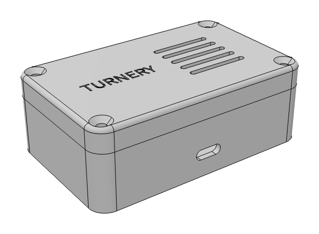
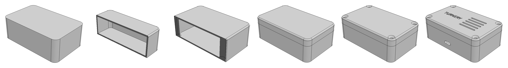
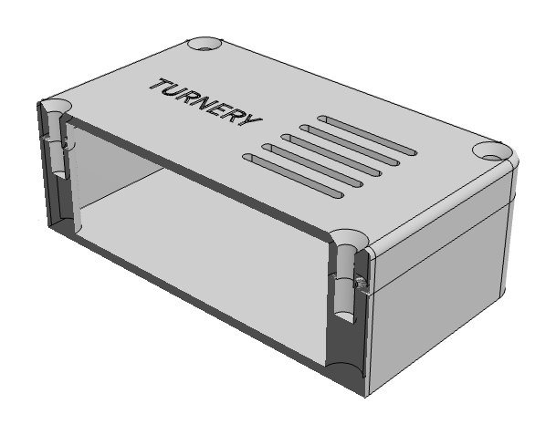

# Sensor enclosure · 传感器外壳



A two-piece, 3D-printable enclosure built by a coding agent through Turnery's MCP tools: 15 tool calls from an empty file to a checked part. Everything in this folder was written by the agent; nothing was edited by hand.

一个两件式、可 3D 打印的外壳，由 coding agent 通过 Turnery 的 MCP 工具建成：从空文件到核对通过，一共 15 次工具调用。这个文件夹里的内容都是 agent 写的，没有手工改过。

## The request · 需求

> 用 turnery 建一个传感器外壳：外形 80×50×28，壁厚 2，四角 R6。分成底壳和上盖，四角用 M3 沉头螺钉拧进底壳的热熔螺母。前壁开一个 USB-C 口，上盖开 5 条散热槽，刻上 TURNERY。建完核对尺寸再看一眼。

In English: an 80×50×28 mm sensor enclosure, 2 mm walls, R6 corners, split into a base and a lid, held by four M3 countersunk screws into heat-set inserts, a USB-C opening in the front wall, five vent slots and an engraved label on the lid. Check the dimensions and take a look when done.

## What the agent produced · agent 交出来的

`enclosure.turnery.json` is the whole part: 11 named parameters, 17 features, 5 requirement checks.

| # | Feature | Tool | Why (the `intent` the agent wrote) |
| --- | --- | --- | --- |
| 1 | 实心外形 | `sketch` + `extrude` | One solid block first, so the two halves line up by construction |
| 2 | 顶面圆角 | `fillet` | Round the lid's outer edge |
| 3 | 挖内腔 | `sketch` + `extrude` (cut) | Leave one wall thickness top and bottom |
| 4 | 螺丝柱 | `sketch` + `extrude` (`until: "next"`) | Posts grow until they hit the ceiling, so they follow the height |
| 5 | 分成底壳和上盖 | `split` | One cut at `zs`; posts and outline stay aligned |
| 6 | 热熔螺母孔 | `hole` (`M3`, `fit: "insert"`) | Standard insert pocket, no table lookup |
| 7 | 沉头螺钉孔 | `hole` (`M3`, `head: "csink"`) | Screw heads sit flush |
| 8 | USB-C 开口 | `sketch` + `extrude` (cut) | Slot through the front wall |
| 9 | 散热槽 ×5 | `extrude` (cut) + `linear_pattern` | Count and spacing stay editable |
| 10 | 刻字 | `sketch` (text) + `extrude` (cut) | 0.4 mm deep label |



The checks are stored in the file and re-measured by the kernel on every rebuild:

```
✓ size     外形 80×50×28            要求 80 × 50 × 28，实际 80 × 50 × 28
✓ wall     壁厚 2                   要求 2 mm，实际 2 mm
✓ inserts  四角 M3 热熔螺母         要求 4 个 ⌀4，实际 4 个 ⌀4
✓ screws   上盖 4 个 M3 沉头过孔    要求 4 个 ⌀3.4，实际 4 个 ⌀3.4
✓ seat     上盖要落在底壳上,不能有缝  要求 贴在一起，实际 接触（距离 0）
```



## Try it · 试一下

Open the file in Turnery (File → Open, or `turnery open examples/sensor-enclosure/enclosure.turnery.json`), then:

- Drag `t` from 2 to 3 in the parameter panel. The cavity, posts and holes follow; the `wall` check turns red because the request said 2.
- Change `H` to 40. The posts were built "until next", so they grow with the box.
- Click the front wall, leave a note such as "把 USB-C 口换成 Micro-USB，宽 8 高 3", and tell your agent to read the notes.
- Re-check without a window: `turnery check examples/sensor-enclosure/enclosure.turnery.json --no-app`
- Export: `turnery export examples/sensor-enclosure/enclosure.turnery.json out/enclosure.step` (or `.stl`, which gives one file per part in a zip).
